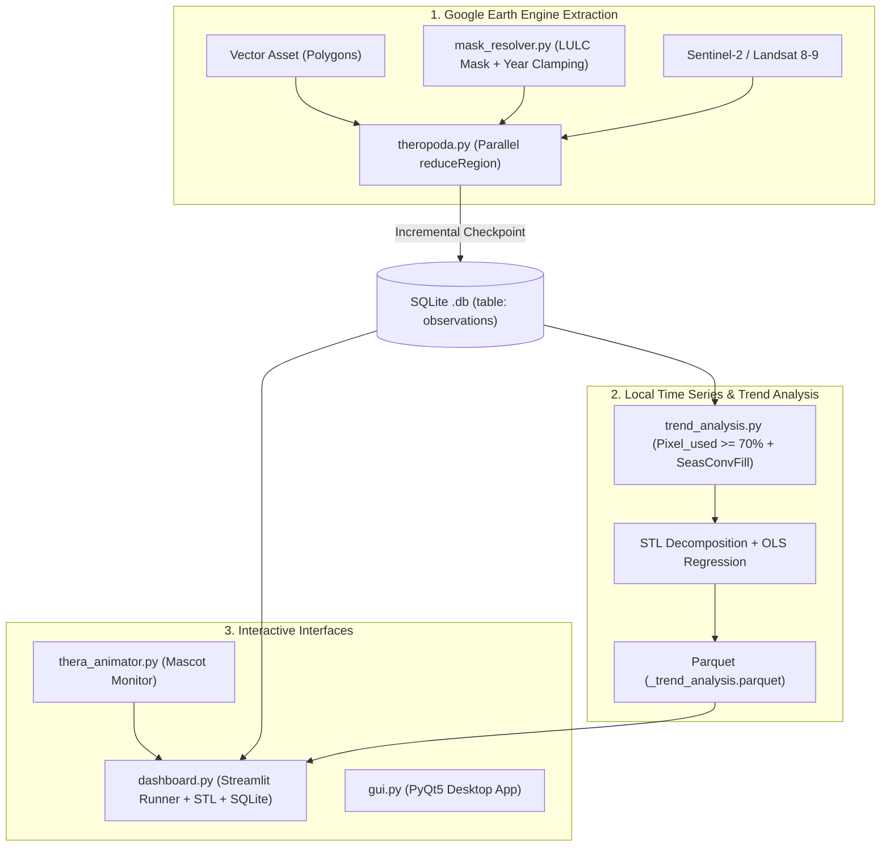

<p align="center">
  
</p>

# 🦖 T(h)eroPoDa+ v3.1 — Time Series Extraction for Polygonal Data & Trend Analysis

[](./LICENSE)
[](https://lapig-ufg.github.io/TheroPoDa/)

> **Documentation & Visual Examples:** [https://lapig-ufg.github.io/TheroPoDa/](https://lapig-ufg.github.io/TheroPoDa/)

**TheroPoDa+** extracts cloud-masked median NDVI time series from **Sentinel-2** and **Landsat 8/9** in Google Earth Engine (GEE) for polygonal vector assets, stores incremental checkpoints in **SQLite**, applies seasonal gap-filling (`SeasConvFill`) and robust **STL + OLS** trend decomposition, and provides an **interactive Streamlit Dashboard** and **PyQt5 Desktop GUI**.

- **Author:** Vinícius Vieira Mesquita (`vinicius.mesquita@ufg.br`)
- **Co-author:** Leandro Leal Parente (`leandro.parente@opengeohub.org `)

---

## Architecture & Data Flow



---

## Quickstart

### 1. Environment Setup

Using **`uv`** (recommended):
```bash
uv venv --python 3.10
uv sync --all-extras
uv run pip install 'git+https://github.com/openlandmap/scikit-map#egg=scikit-map[full]'
uv run earthengine authenticate
```

Using **WSL (Ubuntu/Debian with preinstalled GDAL/geospatial stack)**:
```powershell
wsl pip3 install --user --break-system-packages streamlit
wsl earthengine authenticate   # if not already authenticated
```

### 2. Run via Interactive Dashboard (Recommended)

```bash
# Local / Linux / macOS
streamlit run dashboard.py

# From Windows PowerShell using WSL
wsl python3 -m streamlit run dashboard.py --server.address 0.0.0.0 --server.port 8501 --server.headless true
```

Open **http://localhost:8501**:
- **🚀 Executar Pipeline:** Configure all CLI parameters, start extraction in the background, and watch real-time auto-scrolling logs + the **Thera** mascot monitor (`Thera/animations_web/`).
- **📊 Tabela & Tendências:** Filter polygons by `trend_pv`, `r2`, and trend direction; inspect distributions and export CSV.
- **📈 Série Temporal por Polígono:** Inspect the 4-panel **STL Decomposition** (`Observed`, `Trend + OLS`, `Season`, `Resid`) with optional raw `.db` overlay.
- **🗄️ Explorador do Banco SQLite:** Query `observations` (or legacy `restoration`) directly with optional `WHERE` clauses.

### 3. Run via CLI

```bash
# Unmasked Sentinel-2 extraction
python3 main.py \
  -a users/vieiramesquita/LAPIG_FieldSamples/lapig_goias_fieldwork_2022_50m \
  -id ID_POINTS \
  -c Sentinel \
  -o LAPIG_S2_NDVI \
  -start 2019-01-01 \
  -end 2026-01-01

# Custom LULC mask with multiple classes (automatic year detection & clamping)
python3 main.py \
  -a users/vieiramesquita/LAPIG_FieldSamples/lapig_goias_fieldwork_2022_50m \
  -id ID_POINTS \
  -c Sentinel \
  -o LAPIG_Pasture_Grasslands \
  -start 2020-01-01 \
  -end 2026-01-01 \
  -p ee-vieiramesquita \
  -m projects/mapbiomas-public/assets/brazil/lulc/collection11/mapbiomas_brazil_collection11_coverage_v3 \
  -mc 15 11 12
```

### 4. Run via Desktop GUI (PyQt5)

```bash
python3 gui.py
```

---

## CLI Reference

| Flag | Long Flag | Required | Default | Description |
|:---|:---|:---:|:---|:---|
| `-a` | `--asset` | Yes | — | Earth Engine Vector Asset (`FeatureCollection`) |
| `-id` | `--id_field` | Yes | — | Unique polygon ID column (must have 1 unique value per feature) |
| `-c` | `--collection` | Yes | — | `Sentinel` or `Landsat` |
| `-o` | `--output_name` | Yes | — | Base output filename |
| `-of` | `--output_folder` | No | `""` | Output directory |
| `-start` | `--start_date` | Yes | — | Start date (`YYYY-MM-DD`) |
| `-end` | `--end_date` | Yes | — | End date (`YYYY-MM-DD`) |
| `-w` | `--window` | No | `15` (S2) / `16` (LS) | Temporal standardization window (days) |
| `-n` | `--n_cores` | No | `12` | Parallel `joblib` workers |
| `-p` | `--project` | No | `None` | Google Cloud / Earth Engine project ID |
| `-m` | `--mask` | No | `None` | GEE `Image`/`ImageCollection` asset or preset (`mapbiomas-pasture`, `mapbiomas-pasture-grasslands`) |
| `-mc` | `--mask-classes` | No | `None` | Class ID(s) to keep (e.g. `15 11 12` or `15,11,12`) |
| `-t` | `--timeout` | No | `600` | Per-polygon GEE timeout in seconds before killing process and retrying 30 m |
| `-i` | `--indices` | No | `NDVI` | Spectral index preset(s): `NDVI`, `EVI`, `SAVI`, `NDMI`, `NDWI`, `NBR`, `BSI`, `GNDVI`, `PSRI` (Sentinel-2 only) |
| — | `--mask-start-year` | No | `None` | First year for multiband masks whose band names lack years |
| — | `--mask-band` | No | `None` | Explicit band name for static single-band extraction |

---

## AI-Friendly Reference (Module Map & Invariants)

### Repository Layout

| File | Responsibility | Key Entrypoints / Symbols |
|:---|:---|:---|
| [`main.py`](main.py) | CLI parser & pipeline orchestrator | `run_analysis(...)`, `build_arg_parser()` |
| [`dashboard.py`](dashboard.py) | Streamlit runner, STL 3-panel viewer & SQLite explorer | `main()`, `_render_runner_tab()`, `_render_live_log()`, `_render_thera_sidebar()` |
| [`gui.py`](gui.py) | PyQt5 desktop frontend | `TheroPoDaGUI`, `AnalysisThread` |
| [`theropoda/extractor.py`](theropoda/extractor.py) | GEE NDVI extraction, local vectors & SQLite checkpointing | `init_ee(project)`, `getTimeSeries(...)`, `build_id_list(...)`, `run(...)` |
| [`theropoda/masks.py`](theropoda/masks.py) | Dynamic GEE mask inspection & year clamping | `inspect_mask_spec(...)`, `parse_year_bands(...)`, `build_ee_mask(...)` |
| [`theropoda/indices.py`](theropoda/indices.py) | 9 spectral index presets with scaled reflectance | `INDEX_PRESETS`, `parse_indices_arg(...)`, `compute_ee_indices(...)` |
| [`theropoda/trends.py`](theropoda/trends.py) | Window aggregation, `SeasConvFill`, `STL`, `OLS` | `extract_ts(...)`, `gapfill(...)`, `sm_trend(...)`, `run(...)` |
| [`theropoda/animator.py`](theropoda/animator.py) | State machine & GIF loader for `assets/thera/` | `load_thera_sprites()`, `resolve_thera_state(...)`, `count_log_errors(...)` |
| [`assets/`](assets/) | Banner `Logo.gif`, app icons, and 9 Thera GIF animations | `Logo.gif`, `icon.ico`, `thera/*.gif` |
| [`docs/`](docs/) | MkDocs Material documentation & visual examples | `index.md`, `dashboard.md`, `masks.md`, `examples.md` |

### Key Design Invariants
1. **Unique Polygon IDs (`--id_field`):** Every feature in the input GEE Asset or local vector file must have a **strictly unique** value in `--id_field`. Duplicate IDs overwrite/merge geometry mappings and corrupt per-polygon checkpointing and trend aggregation. If your file lacks a unique ID column, create one beforehand (e.g. `gdf["ID_UNICO"] = range(1, len(gdf) + 1)`).
2. **Lazy GEE Initialization:** `theropoda.init_ee(project)` is never executed on module import; it initializes lazily inside execution functions so `--help`, tests, and UIs work without active GEE sessions.
2. **Dynamic Mask Year Clamping:** `inspect_mask_spec()` inspects `bandNames()` or `system:time_start` once before parallel workers start. During extraction, `clamped_year = clamp(img_year, min_year, max_year)` ensures out-of-range satellite years (e.g. `2025–2026` with maps up to `2024`) automatically use the nearest available map.
3. **SQLite Schema & Resume:** Extraction writes to table `observations` (with WAL mode and `timeout=60`). Downstream readers (`main.py`, `trend_analysis.py`, `dashboard.py`) check `observations` and fall back to legacy `restoration`. Completed IDs are pre-filtered once in `theropoda.run()`.
4. **Empty vs. Failed Polygons:** Polygons with zero valid pixels after cloud/LULC masking are logged to `*_empty_polygon.txt` without triggering `bestEffort=True`; only GEE exceptions retry with `bestEffort=True` and log to `*_errors_polygon.txt`.
5. **Seasonality Calculation:** `season_size = max(3, round(365 / eff_window))` represents one annual cycle for `SeasConvFill` and `STL(robust=True)`.

### Verification Commands

```bash
python3 -m py_compile mask_resolver.py theropoda.py trend_analysis.py main.py gui.py dashboard.py thera_animator.py
python3 main.py --help
```

---

## Changelog

### v3.1.1 (2026-11)
- **Observed-Span Gap-Filling & Trend Analysis (`theropoda/trends.py`, `dashboard.py`):** Restricted `SeasConvFill` gap-filling, `STL`, and `OLS` strictly to each polygon's observed date span (`[first_valid : last_valid + 1]`), preventing synthetic extrapolation into years before or after real observations.
- **OLS Intercept Metrics in Dashboard (`dashboard.py`):** Added mean `intercept_m` KPI, `intercept_m`/`intercept_pv` scatter hover details, and per-polygon `intercept_m`, `intercept_sd`, `intercept_tv`, and `intercept_pv` cards in the time series tab.
- **Adaptive GEE Rate-Limit & Concurrency Control (`theropoda/extractor.py`):** Added exponential backoff on GEE HTTP 429 / concurrency errors and automatic worker halving (e.g., `12 → 6 → 3 → 1`) when restricted-mode throttling occurs.
- **Dashboard Process Control & Cleanup (`dashboard.py`):** Added a process-tree Stop button to interrupt running pipelines cleanly, a button to remove generated output/log files, and updated deprecated `st.components.v1.html`/`use_container_width` calls to `st.iframe` and `width="stretch"`.

### v3.1.0 (2026-11)
- **Spectral Index Presets & Multi-Index Extraction (`theropoda/indices.py`):** Added 9 index presets (`NDVI`, `EVI`, `SAVI`, `NDMI`, `NDWI`, `NBR`, `BSI`, `GNDVI`, and Sentinel-2 `PSRI`) via `-i` / `--indices`, applying Sentinel-2 reflectance scaling (`* 0.0001`) and Landsat C02 L2 scaling (`* 0.0000275 - 0.2`) before computing indices.
- **Multi-Index Trend Analysis & Dashboard:** Multiple selected indices are stored together in SQLite (`<IDX>_median`), decomposed independently in `theropoda/trends.py` (with `index_name` partitioning), and selectable in `dashboard.py` and `gui.py`.
- **Resilient Process Timeout (`-t` / `--timeout`):** Added 600 s per-polygon subprocess timeout with automatic termination and `bestEffort=True` (30 m) fallback.
- **Clean Package Layout:** Reorganized core modules under `theropoda/` and media under `assets/`, removing 13k+ unused vendored files.

### v3.0.0 (2026-11)
- **Local Vector Support (No GEE Upload Required):** `-a` / `--asset` now accepts local `.gpkg`, `.shp`, `.geojson`, `.parquet`, and `.zip` files directly via `geopandas` (`is_local_vector` / `load_local_geometries`), with upload support in the Streamlit Dashboard and file picker in `gui.py`.
- **Unified Branch (`v3` / `main`):** Merged CLI, PyQt5 GUI (`gui.py`), `uv` / WSL setup, and dynamic LULC masking into a single codebase.
- **Dynamic LULC Masks & Multi-Class Support (`mask_resolver.py`):** Added `--mask` (`-m`) for presets (`mapbiomas-pasture`, `mapbiomas-pasture-grasslands`) or custom GEE `Image`/`ImageCollection` assets, `--mask-classes` (`-mc`), `--mask-start-year`, `--mask-band`, and automatic year clamping (`[min_year, max_year]`).
- **Interactive Streamlit Dashboard (`dashboard.py`) + Thera Monitor (`thera_animator.py`):** Added background pipeline runner with real-time auto-scrolling logs (F5-safe via `.theropoda_last_run.json`), `trend_m` distribution/significance plots, 3-panel STL decomposition, SQLite explorer, and 9 animated Thera mascot states.
- **Extraction & Reliability Fixes:** Applied GEE `.filterDate(start_date, end_date)` during extraction, removed `.toList(imgCol.size())` overhead, pre-filtered completed IDs once in `theropoda.run()`, enabled SQLite WAL mode + `timeout=60`, separated empty-after-mask polygons (`*_empty_polygon.txt`) from real GEE errors, renamed SQLite table to `observations` (with `restoration` fallback), and fixed `--window` / `season_size` parsing in `main.py`.
- **Documentation & Packaging:** Updated MkDocs Material site (`https://lapig-ufg.github.io/TheroPoDa/`), `pyproject.toml`, `LICENSE`, and `CITATION.cff`.

### v2.0.0
- Added Landsat 8/9 support alongside Sentinel-2 (`Cloud Score+`), `--collection`, `--start_date`, `--end_date`, `--window`, and `STL` + `OLS` trend analysis (`trend_analysis.py`).

### v1.1.0
- Initial Sentinel-2 median NDVI extraction to SQLite and `SeasConvFill` gap-filling.

---

## License & Authors

Licensed under the [MIT License](./LICENSE).

- **Vinícius Vieira Mesquita** — LAPIG / UFG (`vinicius.mesquita@ufg.br`)
- **Leandro Leal Parente** — (`leal.parente@gmail.com`)

