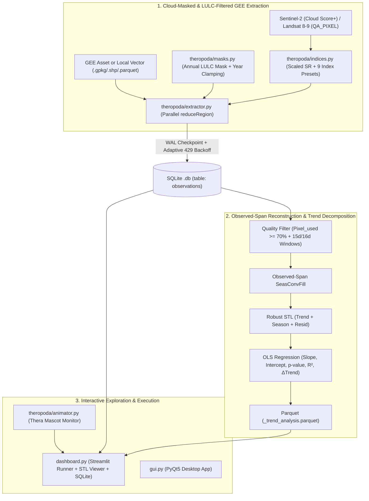

<p align="center">
  
</p>

# 🦖 T(h)eroPoDa+ v3.1.1 — Polygonal Satellite Time-Series Extraction & Robust Trend Analysis

[](./LICENSE)
[](https://github.com/lapig-ufg/TheroPoDa/releases/tag/v3.1.1)
[](https://lapig-ufg.github.io/TheroPoDa/)

> **Full Documentation & Visual Gallery:** [https://lapig-ufg.github.io/TheroPoDa/](https://lapig-ufg.github.io/TheroPoDa/)

**TheroPoDa+** (*Time-series Extraction for Polygonal Data + Trend Analysis*) is an end-to-end geospatial toolkit that extracts cloud-masked, LULC-filtered multi-spectral time series from **Sentinel-2** (`10 m`) and **Landsat 8/9** (`30 m`) in Google Earth Engine (GEE) across thousands of polygons, checkpoints every observation into **SQLite**, reconstructs cloud gaps via seasonal convolution (`SeasConvFill`), and quantifies structural vegetation gain or degradation using **Robust STL + OLS** regression — accessible via **CLI**, **Streamlit Dashboard**, or **PyQt5 Desktop GUI**.

- **Author:** Vinícius Vieira Mesquita (`vinicius.mesquita@ufg.br`) — LAPIG / UFG
- **Co-author:** Leandro Leal Parente (`leandro.parente@opengeohub.org`) — OpenGeoHub

---

## 📖 Why TheroPoDa+? (The Story Behind the Algorithm)

Tracking how thousands of pasture paddocks, ecological restoration plots, farms, or conservation units evolve over 5–10+ years of optical satellite imagery sounds simple — until you hit four real-world remote sensing bottlenecks:

1. **Clouds & Sensor Artifacts:** Persistent wet-season cloud cover and residual cloud shadows create sharp false drops in vegetation indices.
2. **Mixed-Pixel Contamination Inside Polygons:** Real-world property or paddock boundaries often enclose gallery forests, water ponds, roads, or bare structures alongside the target land cover, diluting the spectral signal you actually want to measure.
3. **GEE Scale, Quotas & Interrupted Runs:** Extracting multi-year pixel medians across thousands of polygons triggers Google Earth Engine concurrency limits (`HTTP 429`), per-polygon memory timeouts, or network drops that ruin uncheckpointed scripts.
4. **Seasonality Masking True Change:** Tropical grasslands, pastures, and deciduous canopies swing dramatically between wet and dry seasons; fitting a naive linear regression to noisy, irregular observations confuses phenology or missing rainy-season scenes with real land degradation or recovery.

**TheroPoDa+** was engineered at **LAPIG / UFG** to solve all four problems in a single, fault-tolerant pipeline — accepting either **GEE FeatureCollection Assets** or **local vector files** (`.gpkg`, `.shp`, `.geojson`, `.parquet`, `.zip`) without requiring manual GEE uploads.

---

## ⚙️ How the Algorithm Works (Step by Step)



### Stage 1 — Cloud Screening & Surface Reflectance Scaling
Every satellite scene intersecting a polygon is radiometrically scaled to physical surface reflectance ($\rho \in [0, 1]$) and strictly cloud-screened before index computation:
- **Sentinel-2 SR Harmonized (`10 m`):** Linked with Google **Cloud Score+** (`GOOGLE/CLOUD_SCORE_PLUS/V1/S2_HARMONIZED`), keeping pixels with `cs >= 0.50`, masking sensor band edges (`B8A`/`B9`), and scaling bands by `× 0.0001`.
- **Landsat 8 & 9 Collection 2 Tier 1 L2 (`30 m`):** Filtered via `QA_PIXEL` clear-sky bitmasks (`21824`, `21952`) and scaled by `× 0.0000275 - 0.2`.

### Stage 2 — Multi-Index Spectral Presets (`theropoda/indices.py`)
In a single GEE `reduceRegion` pass (`ee.Reducer.median()` + `ee.Reducer.count()`), TheroPoDa+ computes **1 or more spectral indices simultaneously**, storing `<IDX>_median`, valid `Pixel_Count`, and `Total_Pixels` for every scene:

| Preset | Full Name | Formula (Scaled Surface Reflectance) | Sensors | Typical Application |
|:---|:---|:---|:---:|:---|
| **`NDVI`** | Normalized Difference Vegetation Index | `(NIR - RED) / (NIR + RED)` | S2, L8/9 | General green canopy vigor & biomass |
| **`EVI`** | Enhanced Vegetation Index | `2.5 * (NIR - RED) / (NIR + 6*RED - 7.5*BLUE + 1)` | S2, L8/9 | Dense canopy & pasture vigor without saturation |
| **`SAVI`** | Soil-Adjusted Vegetation Index | `1.5 * (NIR - RED) / (NIR + RED + 0.5)` | S2, L8/9 | Sparse vegetation / high soil background |
| **`NDMI`** | Normalized Difference Moisture Index | `(NIR - SWIR1) / (NIR + SWIR1)` | S2, L8/9 | Canopy water content & drought stress |
| **`NDWI`** | Normalized Difference Water Index | `(GREEN - NIR) / (GREEN + NIR)` | S2, L8/9 | Surface water & flooding detection |
| **`NBR`** | Normalized Burn Ratio | `(NIR - SWIR2) / (NIR + SWIR2)` | S2, L8/9 | Fire severity, burn scars & forest recovery |
| **`BSI`** | Bare Soil Index | `((SWIR1 + RED) - (NIR + BLUE)) / ((SWIR1 + RED) + (NIR + BLUE))` | S2, L8/9 | Exposed soil & severe pasture degradation |
| **`GNDVI`** | Green NDVI | `(NIR - GREEN) / (NIR + GREEN)` | S2, L8/9 | Chlorophyll concentration & nitrogen status |
| **`PSRI`** | Plant Senescence Reflectance Index | `(RED - BLUE) / RED_EDGE2` | S2 only | Dry vegetation, litter & senescence (`B6` Red-Edge) |

### Stage 3 — Dynamic Annual LULC Masking & Year Clamping (`theropoda/masks.py`)
When `--mask` (`-m`) is enabled (e.g., `mapbiomas-pasture`, `mapbiomas-pasture-grasslands`, or any custom GEE `Image`/`ImageCollection` with `--mask-classes`), each satellite scene is masked **year-by-year** so only pixels belonging to your target land-use class(es) contribute to the polygon median.
- **Automatic Year Clamping:** `inspect_mask_spec()` inspects available annual bands once before parallel execution and clamps out-of-range satellite years (`clamp(img_year, min_year, max_year)`). Analyzing `2019–2026` Sentinel-2 imagery with a `1985–2024` LULC map automatically pairs `2019–2024` with their exact annual maps and applies `2024` to `2025–2026` scenes without failing.

### Stage 4 — Self-Healing Parallel Extraction & SQLite Checkpointing (`theropoda/extractor.py`)
- **Zero Lost Progress:** Completed polygons are written incrementally to SQLite (`observations` table in WAL mode). Re-running the same command automatically skips finished polygons and resumes immediately.
- **Adaptive GEE Rate-Limit Control:** If Google Earth Engine returns `HTTP 429 (Too Many Requests / Restricted Mode)`, TheroPoDa+ applies exponential backoff with jitter and **automatically halves worker concurrency** (`12 → 6 → 3 → 1`) to stay within project quotas.
- **Timeout & Scale Fallback:** Polygons exceeding `--timeout` (default `600 s`) or hitting GEE memory limits are cleanly terminated and retried with `bestEffort=True` (`30 m`), while polygons completely masked out by LULC/clouds are separated into `*_empty_polygon.txt`.

### Stage 5 — Observed-Span Gap-Filling (`SeasConvFill`) & Robust `STL + OLS` (`theropoda/trends.py`)
1. **Valid-Pixel Quality Gate (`>= 70%`):** Only scene observations where at least **70%** of the polygon's unmasked pixels were cloud-free (`Pixel_Count / Total_Pixels >= 0.70`) enter the time series, aggregated into standardized windows (`15` days for Sentinel-2 → `24` windows/year; `16` days for Landsat → `23` windows/year).
2. **Strict Observed-Span Reconstruction:** For each polygon, TheroPoDa+ slices strictly between its **first and last valid observation** (`[first_valid : last_valid + 1]`) — never extrapolating synthetic pre- or post-observation history — and reconstructs missing wet-season windows via `scikit-map`'s **`SeasConvFill`** seasonal convolution filter.
3. **Robust STL Decomposition:** Requires at least **2 full seasonal cycles** (~24 months, `2 * season_size`) and decomposes the series via `STL(..., robust=True)` into:
   $$\text{Observed}_t = \text{Trend}_t + \text{Season}_t + \text{Resid}_t$$
4. **OLS Structural Trend Metrics:** Fits Ordinary Least Squares over normalized time $x \in [0, 1]$ on $\text{Trend}_t$, exporting per-polygon diagnostics to `*_trend_analysis.parquet`:
   - **`trend_m` / `trend_sd` / `trend_tv` / `trend_pv`:** Linear trend slope across the observed period, standard error, *t*-statistic, and *p*-value (`trend_pv < 0.05` indicates statistically significant gain or loss).
   - **`intercept_m` / `intercept_sd` / `intercept_tv` / `intercept_pv`:** Baseline initial vigor (OLS intercept) and uncertainty metrics.
   - **`r2`:** Goodness-of-fit ($R^2$) of the linear model against the non-linear STL trend.
   - **`diff_trend`:** Direct end-minus-start structural shift ($\text{Trend}_{\text{last}} - \text{Trend}_{\text{first}}$), capturing net change even when trajectories curve.

---

## 📊 Visual Showcase & Capabilities

The examples below come from a real **LAPIG Goiás fieldwork pasture dataset** (`460` sample polygons, `457` valid pasture polygons extracted, Sentinel-2 `2019–2026`, masked dynamically with MapBiomas Collection 11 Pasture `-mc 15`).

### 1. From Noisy Cloud-Gapped Scenes to Clean Structural Trend
Raw GEE observations (`.db` dots), standardized `SeasConvFill` gap-filled series, non-linear **STL Trend**, and **OLS Slope** evolving across `2019–2026`:

<p align="center">
  
</p>

### 2. Per-Polygon 3-Panel STL Decomposition
Separating multi-year pasture recovery/degradation (**Top**) from recurring wet/dry seasonal phenology (**Middle**) and high-frequency anomalies/residuals (**Bottom**):

<p align="center">
  
</p>

### 3. Landscape-Scale Screening (`trend_m` vs. `trend_pv`)
Across hundreds or thousands of polygons, combining `trend_m` (slope), `trend_pv` (*p*-value `< 0.05` dashed red threshold), and `R²` immediately isolates polygons undergoing **statistically significant degradation** (`trend_m < 0, p < 0.05`) vs. **significant recovery/intensification** (`trend_m > 0, p < 0.05`):

<p align="center">
  
</p>

### 4. Interactive Streamlit Dashboard & Thera Mascot Monitor
While pipelines run in the background (surviving browser refreshes via `.theropoda_last_run.json`), **Thera** reacts live in the sidebar to extraction speed, large batches (`> 1,000` polygons), GEE retry hiccups, and STL/OLS computation:

<p align="center">
  
  
  
  
</p>

---

## 🧪 Practical Recipes & Use Cases

### Recipe 1 — Local GeoPackage + Multi-Index Pasture Diagnostics (No GEE Upload!)
Pass a local `.gpkg` / `.shp` / `.parquet` directly and extract vegetation vigor (`EVI`), canopy moisture (`NDMI`), bare soil (`BSI`), and senescence (`PSRI`) simultaneously over MapBiomas pasture pixels:
```bash
python3 main.py \
  -a ./fazenda_piquetes.gpkg \
  -id ID_POL \
  -c Sentinel \
  -i EVI NDMI BSI PSRI \
  -m mapbiomas-pasture \
  -o Fazenda_Pasture_MultiIndex \
  -start 2019-01-01 \
  -end 2026-11-01 \
  -p my-gee-project
```

### Recipe 2 — Long-Term Ecological Restoration / Burn Recovery (Landsat 8/9, 2014–2026)
Use harmonized `30 m` Landsat 8/9 (`16`-day windows) with `NBR`, `NDVI`, and `NDMI` to track decade-scale canopy recovery after fire or restoration planting:
```bash
python3 main.py \
  -a ./restoration_plots.geojson \
  -id PLOT_ID \
  -c Landsat \
  -i NBR NDVI NDMI \
  -o Restoration_L89_2014_2026 \
  -start 2014-01-01 \
  -end 2026-01-01 \
  -p my-gee-project
```

### Recipe 3 — Custom LULC Asset with Multi-Class Filtering (Cerrado / Pantanal / Pampa)
Combine cultivated pastures (`15`), wetlands (`11`), and native grasslands (`12`) from a MapBiomas Collection asset with automatic annual clamping:
```bash
python3 main.py \
  -a users/vieiramesquita/LAPIG_FieldSamples/lapig_goias_fieldwork_2022_50m \
  -id ID_POINTS \
  -c Sentinel \
  -i NDVI EVI \
  -o LAPIG_Pasture_Grasslands \
  -start 2020-01-01 \
  -end 2026-01-01 \
  -p ee-vieiramesquita \
  -m projects/mapbiomas-public/assets/brazil/lulc/collection11/mapbiomas_brazil_collection11_coverage_v3 \
  -mc 15 11 12
```

---

## 🚀 Quickstart

### 1. Environment Setup

Using **`uv`** (recommended):
```bash
uv venv --python 3.10
uv sync --all-extras
uv run pip install 'git+https://github.com/openlandmap/scikit-map#egg=scikit-map[full]'
uv run earthengine authenticate
```

Using **WSL (Ubuntu/Debian with preinstalled GDAL/geospatial stack)**:
```powershell
wsl pip3 install --user --break-system-packages streamlit
wsl earthengine authenticate   # if not already authenticated
```

### 2. Launch Interactive Streamlit Dashboard (Recommended)

```bash
# Local / Linux / macOS
streamlit run dashboard.py

# From Windows PowerShell using WSL
wsl python3 -m streamlit run dashboard.py --server.address 0.0.0.0 --server.port 8501 --server.headless true
```

Open **http://localhost:8501**:
- **🚀 Executar Pipeline:** Configure GEE assets or upload local vectors, select multi-index presets, start/stop jobs cleanly, or clean up generated outputs while watching real-time logs + **Thera**.
- **📊 Tabela & Tendências:** Explore KPIs (`trend_m`, `intercept_m`, significant gain/loss counts), interactive scatter/histogram plots, and export filtered CSVs.
- **📈 Série Temporal por Polígono:** Inspect per-polygon `trend_*` and `intercept_*` cards alongside interactive 3-panel **STL + OLS** plots with raw `.db` observation overlays.
- **🗄️ Explorador do Banco SQLite:** Query `observations` (or legacy `restoration`) directly with custom SQL `WHERE` clauses.

### 3. Launch Desktop GUI (PyQt5)

```bash
python3 gui.py
```

---

## 🛠️ CLI Reference

| Flag | Long Flag | Required | Default | Description |
|:---|:---|:---:|:---|:---|
| `-a` | `--asset` | Yes | — | GEE `FeatureCollection` Asset ID **or** local vector path (`.gpkg`, `.shp`, `.geojson`, `.parquet`, `.zip`) |
| `-id` | `--id_field` | Yes | — | Unique polygon ID column (must have 1 unique value per feature) |
| `-c` | `--collection` | Yes | — | `Sentinel` or `Landsat` |
| `-o` | `--output_name` | Yes | — | Base output filename |
| `-of` | `--output_folder` | No | `""` | Output directory |
| `-start` | `--start_date` | Yes | — | Start date (`YYYY-MM-DD`) |
| `-end` | `--end_date` | Yes | — | End date (`YYYY-MM-DD`) |
| `-i` | `--indices` | No | `NDVI` | Spectral index preset(s): `NDVI`, `EVI`, `SAVI`, `NDMI`, `NDWI`, `NBR`, `BSI`, `GNDVI`, `PSRI` (S2 only) |
| `-w` | `--window` | No | `15` (S2) / `16` (LS) | Temporal standardization window (days) |
| `-n` | `--n_cores` | No | `12` | Initial parallel workers (auto-halves on GEE HTTP 429) |
| `-p` | `--project` | No | `None` | Google Cloud / Earth Engine project ID |
| `-m` | `--mask` | No | `None` | GEE `Image`/`ImageCollection` asset or preset (`mapbiomas-pasture`, `mapbiomas-pasture-grasslands`) |
| `-mc` | `--mask-classes` | No | `None` | Class ID(s) to keep (e.g. `15 11 12` or `15,11,12`) |
| `-t` | `--timeout` | No | `600` | Per-polygon GEE timeout in seconds before killing process and retrying 30 m |
| — | `--mask-start-year` | No | `None` | First year for multiband masks whose band names lack years |
| — | `--mask-band` | No | `None` | Explicit band name for static single-band extraction |

---

## 🧩 Architecture & Module Reference

### Repository Layout

| File | Responsibility | Key Entrypoints / Symbols |
|:---|:---|:---|
| [`main.py`](main.py) | CLI parser & pipeline orchestrator | `run_analysis(...)`, `build_arg_parser()` |
| [`dashboard.py`](dashboard.py) | Streamlit runner, STL 3-panel viewer & SQLite explorer | `main()`, `_render_runner_tab()`, `_render_live_log()`, `_render_thera_sidebar()` |
| [`gui.py`](gui.py) | PyQt5 desktop frontend | `TheroPoDaGUI`, `AnalysisThread` |
| [`theropoda/extractor.py`](theropoda/extractor.py) | GEE extraction, local vectors, adaptive 429 control & SQLite checkpointing | `init_ee(project)`, `getTimeSeries(...)`, `build_id_list(...)`, `run(...)` |
| [`theropoda/masks.py`](theropoda/masks.py) | Dynamic GEE mask inspection & year clamping | `inspect_mask_spec(...)`, `parse_year_bands(...)`, `build_ee_mask(...)` |
| [`theropoda/indices.py`](theropoda/indices.py) | 9 spectral index presets with scaled reflectance | `INDEX_PRESETS`, `parse_indices_arg(...)`, `compute_ee_indices(...)` |
| [`theropoda/trends.py`](theropoda/trends.py) | Window aggregation, observed-span `SeasConvFill`, `STL`, `OLS` | `extract_ts(...)`, `gapfill(...)`, `sm_trend(...)`, `run(...)` |
| [`theropoda/animator.py`](theropoda/animator.py) | State machine & GIF loader for `assets/thera/` | `load_thera_sprites()`, `resolve_thera_state(...)`, `count_log_errors(...)` |
| [`assets/`](assets/) | Banner `Logo.gif`, app icons, and 9 Thera GIF animations | `Logo.gif`, `icon.ico`, `thera/*.gif` |
| [`docs/`](docs/) | MkDocs Material documentation & visual examples | `index.md`, `dashboard.md`, `masks.md`, `examples.md`, `trend_analysis.md` |

### Key Design Invariants
1. **Unique Polygon IDs (`--id_field`):** Every feature in the input GEE Asset or local vector file must have a **strictly unique** value in `--id_field`. If your file lacks a unique ID column, create one beforehand (e.g. `gdf["ID_UNICO"] = range(1, len(gdf) + 1)`).
2. **Lazy GEE Initialization:** `theropoda.extractor.init_ee(project)` initializes lazily inside execution functions so `--help`, tests, and UIs work without active GEE credentials.
3. **Observed-Span Integrity:** `theropoda/trends.py` runs `SeasConvFill`, `STL`, and `OLS` strictly inside each polygon's valid observation span (`[first_valid : last_valid + 1]`), leaving `NaN` outside that window.
4. **SQLite Schema & Resume:** Extraction writes to table `observations` (WAL mode, `timeout=60`) with fallback support for legacy `restoration` tables.
5. **Empty vs. Failed Polygons:** Polygons with zero valid pixels after cloud/LULC masking are logged to `*_empty_polygon.txt` without triggering `bestEffort=True`; only GEE exceptions retry at `30 m` and log to `*_errors_polygon.txt`.

### Verification Commands

```bash
python3 -m py_compile main.py gui.py dashboard.py theropoda/*.py
python3 main.py --help
```

---

## 📜 Changelog

### v3.1.1 (2026-11)
- **Observed-Span Gap-Filling & Trend Analysis (`theropoda/trends.py`, `dashboard.py`):** Restricted `SeasConvFill` gap-filling, `STL`, and `OLS` strictly to each polygon's observed date span (`[first_valid : last_valid + 1]`), preventing synthetic extrapolation into years before or after real observations.
- **OLS Intercept Metrics in Dashboard (`dashboard.py`):** Added mean `intercept_m` KPI, `intercept_m`/`intercept_pv` scatter hover details, and per-polygon `intercept_m`, `intercept_sd`, `intercept_tv`, and `intercept_pv` cards in the time series tab.
- **Adaptive GEE Rate-Limit & Concurrency Control (`theropoda/extractor.py`):** Added exponential backoff on GEE HTTP 429 / concurrency errors and automatic worker halving (e.g., `12 → 6 → 3 → 1`) when restricted-mode throttling occurs.
- **Dashboard Process Control & Cleanup (`dashboard.py`):** Added a process-tree Stop button to interrupt running pipelines cleanly, a button to remove generated output/log files, and updated deprecated `st.components.v1.html`/`use_container_width` calls to `st.iframe` and `width="stretch"`.

### v3.1.0 (2026-11)
- **Spectral Index Presets & Multi-Index Extraction (`theropoda/indices.py`):** Added 9 index presets (`NDVI`, `EVI`, `SAVI`, `NDMI`, `NDWI`, `NBR`, `BSI`, `GNDVI`, and Sentinel-2 `PSRI`) via `-i` / `--indices`, applying Sentinel-2 reflectance scaling (`* 0.0001`) and Landsat C02 L2 scaling (`* 0.0000275 - 0.2`) before computing indices.
- **Multi-Index Trend Analysis & Dashboard:** Multiple selected indices are stored together in SQLite (`<IDX>_median`), decomposed independently in `theropoda/trends.py` (with `index_name` partitioning), and selectable in `dashboard.py` and `gui.py`.
- **Resilient Process Timeout (`-t` / `--timeout`):** Added 600 s per-polygon subprocess timeout with automatic termination and `bestEffort=True` (30 m) fallback.
- **Clean Package Layout:** Reorganized core modules under `theropoda/` and media under `assets/`, removing 13k+ unused vendored files.

### v3.0.0 (2026-11)
- **Local Vector Support (No GEE Upload Required):** `-a` / `--asset` now accepts local `.gpkg`, `.shp`, `.geojson`, `.parquet`, and `.zip` files directly via `geopandas` (`is_local_vector` / `load_local_geometries`), with upload support in the Streamlit Dashboard and file picker in `gui.py`.
- **Unified Branch (`v3` / `main`):** Merged CLI, PyQt5 GUI (`gui.py`), `uv` / WSL setup, and dynamic LULC masking into a single codebase.
- **Dynamic LULC Masks & Multi-Class Support:** Added `--mask` (`-m`) for presets (`mapbiomas-pasture`, `mapbiomas-pasture-grasslands`) or custom GEE `Image`/`ImageCollection` assets, `--mask-classes` (`-mc`), `--mask-start-year`, `--mask-band`, and automatic year clamping (`[min_year, max_year]`).
- **Interactive Streamlit Dashboard (`dashboard.py`) + Thera Monitor:** Added background pipeline runner with real-time auto-scrolling logs (F5-safe via `.theropoda_last_run.json`), `trend_m` distribution/significance plots, 3-panel STL decomposition, SQLite explorer, and 9 animated Thera mascot states.
- **Extraction & Reliability Fixes:** Applied GEE `.filterDate(start_date, end_date)` during extraction, removed `.toList(imgCol.size())` overhead, pre-filtered completed IDs once in `run()`, enabled SQLite WAL mode + `timeout=60`, separated empty-after-mask polygons (`*_empty_polygon.txt`) from real GEE errors, renamed SQLite table to `observations` (with `restoration` fallback), and fixed `--window` / `season_size` parsing in `main.py`.
- **Documentation & Packaging:** Updated MkDocs Material site (`https://lapig-ufg.github.io/TheroPoDa/`), `pyproject.toml`, `LICENSE`, and `CITATION.cff`.

### v2.0.0
- Added Landsat 8/9 support alongside Sentinel-2 (`Cloud Score+`), `--collection`, `--start_date`, `--end_date`, `--window`, and `STL` + `OLS` trend analysis.

### v1.1.0
- Initial Sentinel-2 median NDVI extraction to SQLite and `SeasConvFill` gap-filling.

---

## 📄 License & Authors

Licensed under the [MIT License](./LICENSE). If you use **TheroPoDa+** in scientific research, please cite [`CITATION.cff`](./CITATION.cff).

- **Vinícius Vieira Mesquita** — LAPIG / UFG (`vinicius.mesquita@ufg.br`)
- **Leandro Leal Parente** — OpenGeoHub (`leandro.parente@opengeohub.org`)

> **AI-Assisted Engineering:** The `v3.x` architecture, multi-index pipeline, interactive dashboard, documentation, and reliability enhancements were developed and refined with the assistance of **Antigravity** (Google DeepMind / Gemini), under the scientific direction and review of the authors.
