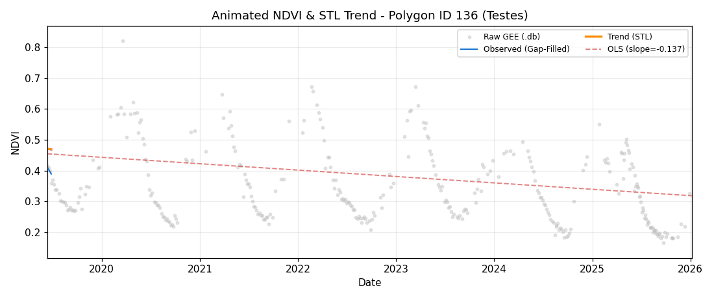
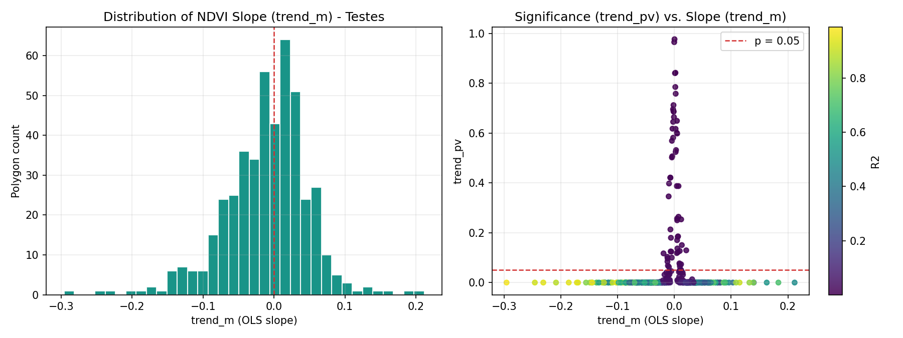
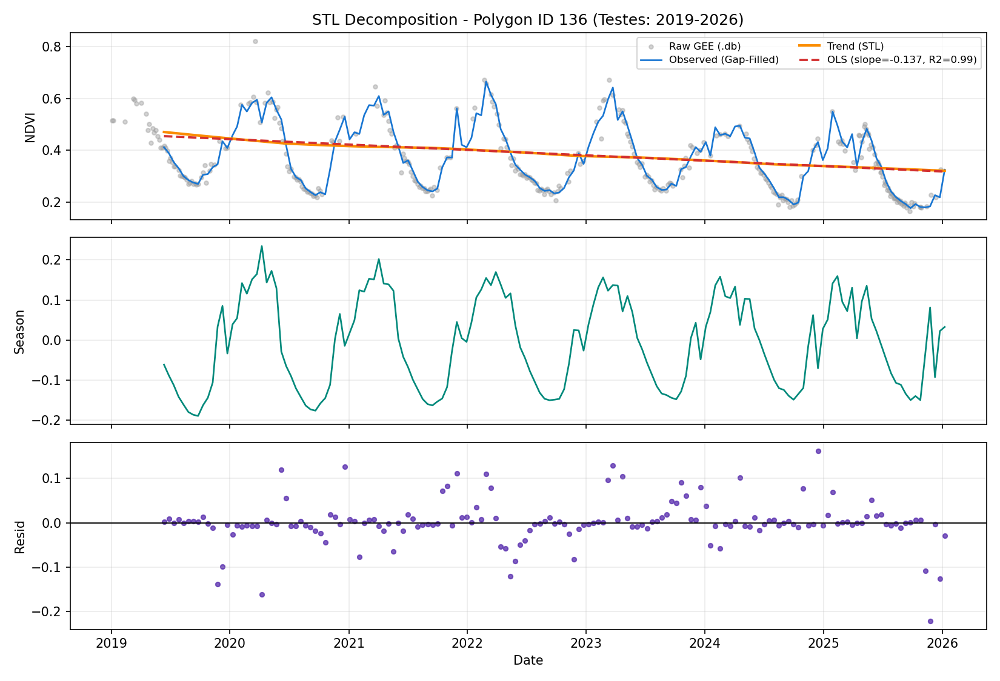

# Visual Examples (`Testes/` Dataset)

Results below were generated using **TheroPoDa+ v3** (`Testes/` run) on the LAPIG Goiás fieldwork sample dataset (`460` polygons total, `457` valid pasture polygons extracted, `3` empty after mask, `0` errors; Sentinel-2 `2019-01-01` to `2026-01-01`, MapBiomas Collection 11 Pasture mask `-mc 15`).

---

## 1. Animated NDVI & STL Trend Progression (`ID_POINTS = 136`)

Progressive animation showing raw GEE observations (`.db`, table `observations`), gap-filled standardized series (`SeasConvFill`), non-linear `STL` trend, and `OLS` linear slope over `2019–2026`:

---

## 2. Landscape Trend Distribution (`trend_m` & `trend_pv`)

Distribution of the OLS trend slope (`trend_m`) and statistical significance (`trend_pv` vs. `trend_m`, colored by `R²`) across all `457` valid polygons:

---

## 3. Per-Polygon 3-Panel STL Decomposition (`ID_POINTS = 136`)

3-panel STL decomposition matching the Dashboard's **Série Temporal por Polígono** tab:
- **Top:** Raw GEE observations (`.db`), gap-filled standardized series, `STL` trend, and `OLS` linear slope.
- **Middle:** Extracted seasonal cycle (`Season`).
- **Bottom:** Residual noise (`Resid`).

