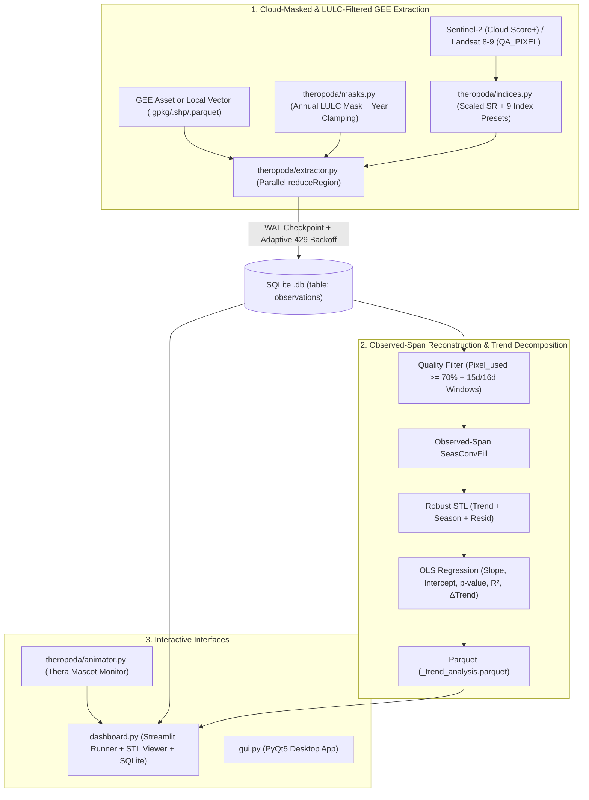

<p align="center">
  
</p>

# 🦖 T(h)eroPoDa+ v3.1.1 — Polygonal Satellite Time-Series Extraction & Trend Analysis

**TheroPoDa+** is an open-source geospatial toolkit for extracting cloud-masked, LULC-filtered multi-index time series (`NDVI`, `EVI`, `SAVI`, `NDMI`, `NDWI`, `NBR`, `BSI`, `GNDVI`, `PSRI`) from **Sentinel-2** (`10 m`) and **Landsat 8/9** (`30 m`) in Google Earth Engine (GEE) across GEE FeatureCollections or local vector files (`.gpkg`, `.shp`, `.geojson`, `.parquet`), storing incremental checkpoints in **SQLite** (`observations`), performing observed-span seasonal gap-filling (`SeasConvFill`) and **Robust STL + OLS** trend analysis, and exploring results in an **interactive Streamlit Dashboard** or **PyQt5 Desktop GUI**.

- **Author:** Vinícius Vieira Mesquita (`vinicius.mesquita@ufg.br`) — LAPIG / UFG
- **Co-author:** Leandro Leal Parente (`leandro.parente@opengeohub.org`) — OpenGeoHub
- **Version:** `3.1.1` | **License:** MIT

---

## How the Algorithm Works



1. **Cloud Screening & Surface Reflectance Scaling:** Sentinel-2 scenes are paired with Google **Cloud Score+** (`cs >= 0.50`, scaled `× 0.0001`); Landsat 8/9 Collection 2 L2 scenes are filtered via `QA_PIXEL` (`21824`, `21952`, scaled `× 0.0000275 - 0.2`).
2. **Multi-Index Extraction (`-i`):** Computes 1 or more presets (`NDVI`, `EVI`, `SAVI`, `NDMI`, `NDWI`, `NBR`, `BSI`, `GNDVI`, and Sentinel-2 `PSRI`) in a single GEE `reduceRegion` pass (`median` + valid `count`).
3. **Dynamic Annual LULC Masking (`-m`, `-mc`):** Filters pixels year-by-year against MapBiomas presets or custom GEE assets, automatically clamping out-of-range years (`[min_year, max_year]`).
4. **Resilient SQLite Checkpointing & Adaptive Rate-Limiting:** Saves each finished polygon to SQLite (`observations`) and automatically halves worker concurrency (`12 → 6 → 3 → 1`) with exponential backoff if GEE triggers `HTTP 429`.
5. **Observed-Span `SeasConvFill` + Robust `STL + OLS`:** Filters scenes with `Pixel_used >= 70%`, reconstructs gaps strictly within each polygon's observed date span (`[first_valid : last_valid + 1]`), and fits `STL(robust=True)` + `OLS` (requiring ≥ 24 months / `2 * season_size`), outputting slope (`trend_*`), baseline (`intercept_*`), `r2`, and `diff_trend`.

---

## Installation

### Option A — Using `uv` (Recommended)

```bash
uv venv --python 3.10
uv sync --all-extras
uv run pip install 'git+https://github.com/openlandmap/scikit-map#egg=scikit-map[full]'
uv run earthengine authenticate
```

### Option B — WSL (Ubuntu / Debian)

```powershell
wsl pip3 install --user --break-system-packages streamlit
wsl earthengine authenticate
```

---

## Quick CLI Examples

> **Important:** The column passed to `-id` / `--id_field` must contain **strictly unique values** (one unique ID per polygon/feature). If your shapefile or GeoPackage has repeated IDs across features, add a sequential unique ID column first (`gdf["ID_UNICO"] = range(1, len(gdf) + 1)`).

```bash
# Local GeoPackage + Multi-Index Pasture Monitoring (no GEE Asset upload required!)
python3 main.py \
  -a ./meus_talhoes.gpkg \
  -id ID_TALHAO \
  -c Sentinel \
  -i EVI NDMI BSI PSRI \
  -m mapbiomas-pasture \
  -o TALHOES_S2_MULTI \
  -start 2019-01-01 \
  -end 2026-01-01 \
  -p my-gee-project

# Or GEE Asset + Custom Multi-Class LULC Mask
python3 main.py \
  -a users/vieiramesquita/LAPIG_FieldSamples/lapig_goias_fieldwork_2022_50m \
  -id ID_POINTS \
  -c Sentinel \
  -i NDVI EVI \
  -o LAPIG_Pasture_S2 \
  -start 2019-01-01 \
  -end 2026-01-01 \
  -p ee-vieiramesquita \
  -m projects/mapbiomas-public/assets/brazil/lulc/collection11/mapbiomas_brazil_collection11_coverage_v3 \
  -mc 15 11 12
```
