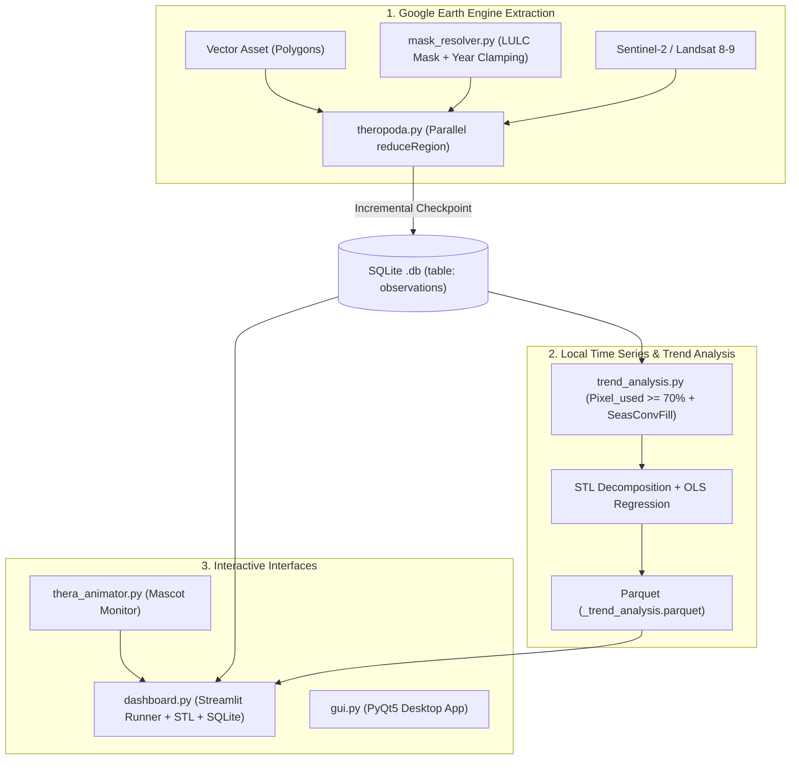

# 🦖 T(h)eroPoDa+ v3 — Time Series Extraction for Polygonal Data & Trend Analysis

**TheroPoDa+** is an open-source toolkit for extracting cloud-masked median NDVI time series from **Sentinel-2** and **Landsat 8/9** in Google Earth Engine (GEE) across polygonal vector assets, storing incremental checkpoints in **SQLite** (`observations`), performing seasonal gap-filling (`SeasConvFill`) and **STL + OLS** trend analysis, and exploring results in an **interactive Streamlit Dashboard** or **PyQt5 Desktop GUI**.

- **Author:** Vinícius Vieira Mesquita (`vinicius.mesquita@ufg.br`) — LAPIG / UFG
- **Co-author:** Leandro Leal Parente (`leal.parente@gmail.com`)
- **Version:** `3.0.0` | **License:** MIT

---

## Architecture & Data Flow



---

## Installation

### Option A — Using `uv` (Recommended)

```bash
uv venv --python 3.10
uv sync --all-extras
uv run pip install 'git+https://github.com/openlandmap/scikit-map#egg=scikit-map[full]'
uv run earthengine authenticate
```

### Option B — WSL (Ubuntu / Debian)

```powershell
wsl pip3 install --user --break-system-packages streamlit
wsl earthengine authenticate
```

---

## Quick CLI Example

```bash
python3 main.py \
  -a users/vieiramesquita/LAPIG_FieldSamples/lapig_goias_fieldwork_2022_50m \
  -id ID_POINTS \
  -c Sentinel \
  -o LAPIG_Pasture_S2_NDVI \
  -start 2019-01-01 \
  -end 2026-01-01 \
  -p ee-vieiramesquita \
  -m projects/mapbiomas-public/assets/brazil/lulc/collection11/mapbiomas_brazil_collection11_coverage_v3 \
  -mc 15
```
